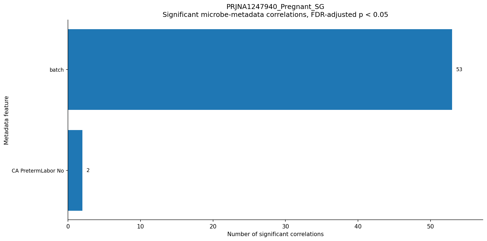
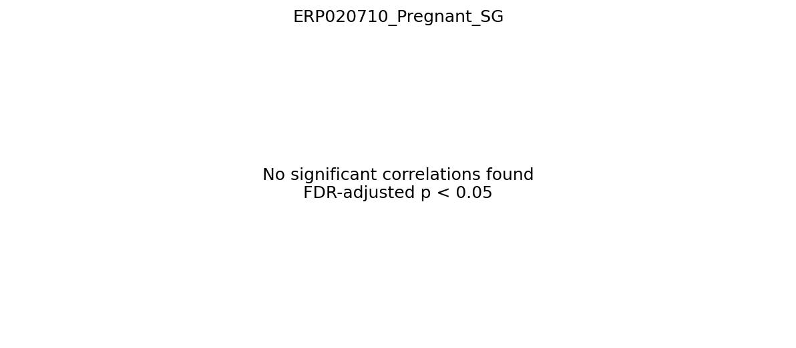
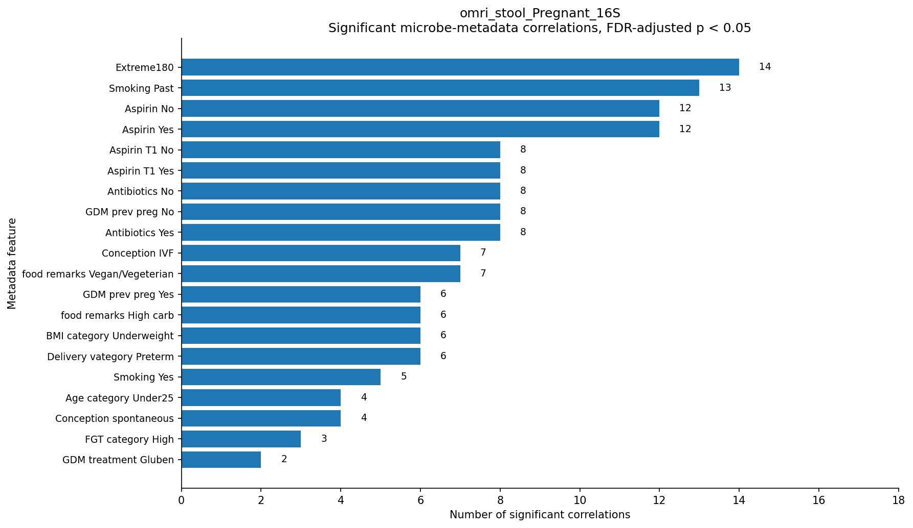
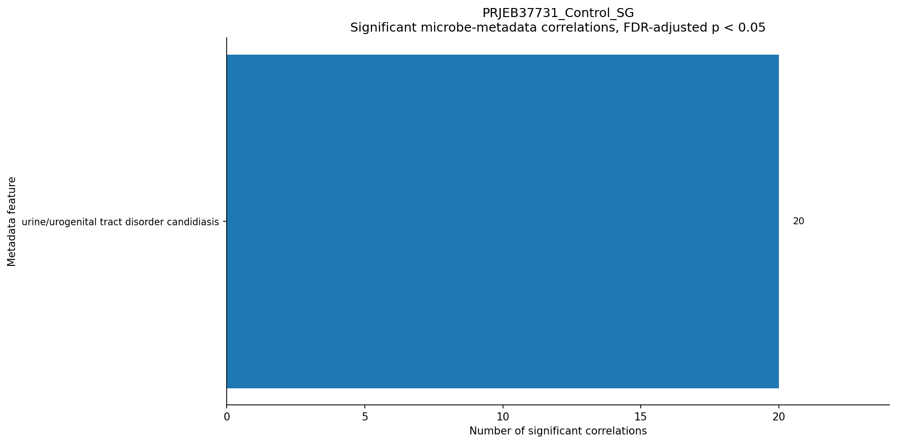

# Projects Overview

| Project Name | Group    | Type | Country | # Samples | V   | metadata |
|--------------|----------|------|---------|--------|------| -------- | 
| PRJNA1247940 | Pregnant | WGS  | USA   |  74    | V     | BMI, batch, Consent_Age, Delivery_EGA, country, Preeclampsia_During_Labor, PreTerm_Labor_EGA, tobacco_use, Birth Weight, delivery_type, sex_of_baby, PretermLabor, GDM, hypertension, Preeclampsia_At_PP, StillBirth |  
| ERP020710    | Pregnant | WGS  | China   |  55    | V     | Age, Body-mass index, Blood _glucose_t=0min, Blood_glucose_t=120mins, Blood_glucose_t=60mins, Disease status, Gestational weeks (fecal sample collection), Gestational weeks (OGTT testing) , Height, Total mass, (manually - https://gigadb.org/dataset/100326 )  | 
| PRJNA1254708 | Pregnant | 16S  | China   |  63    | V need to preprocess     | none - need to contact authors |
| omri_stool   | Pregnant | 16S  | Israel? |  382   | V     | BMI, Age, glucose, number of pregnancies, number of deliveries, way of conception, Antibiotics, Aspirin, Delivery_week, chronic medications, Smoking, Newborn_weight, stress test, education years, calories per day, carbs per day, food preferces |
|--------------|----------|------|---------|--------| ----  | ------- |
| PRJEB37731   | Control  | WGS  | Denmark |  160   | V     | host_body_mass_index, travel_outside_the_country_in_last_six_months, host_disease_status, presence_of_pets_or_farm_animals, drug_usage, urine/urogenital_tract_disorder |
| PRJNA48479   | Control  | WGS  | USA     |  100   | V     | nothing relevant
| PRJNA1067170 | Control  | WGS  | USA     |  124   | need permision to download  | 
| PRJNA669650  | Control  | 16S  | Finland |  208   | V need to preprocess     | Host_age, Host_disease (null/control)  |
| PRJNA388263  | Control  | 16S  | USA     |  400   | V need to preprocess |  
| PRJNA545251  | Control  | 16S  | Barbados, Chile, South Africa, Thailand | 305 | need to preprocess | https://www.nature.com/articles/s41598-022-21779-z |

 

---
# Taxa Changes

## GENUS LEVEL

**Higher in pregnancy:** Mann–Whitney q < 0.05, log2FC (pregnancy vs. control) ≥ 0.5, and the median abundance is higher in pregnancy in at least 80% of all pregnancy–control project comparisons.  
**Lower in pregnancy:** Mann–Whitney q < 0.05, log2FC (pregnancy vs. control) ≤ −0.5, and the median abundance is lower in pregnancy in at least 80% of all pregnancy–control project comparisons.  
**Appears in pregnancy:** Fisher q < 0.05, prevalence ≥ 20% in pregnancy, and prevalence ≤ 2% in controls.  
**Disappears in pregnancy:** Fisher q < 0.05, prevalence ≥ 20% in controls, and prevalence ≤ 2% in pregnancy.  
**Not candidate:** A tested taxon that does not meet any of the criteria above.  

### Shotgun

Pregnancy projects: **ERP020710** and **PRJNA1247940**.
Control projects: **PRJEB37731** and **PRJNA48479**.

Results from the updated SG analysis: **358** tested genera, **127** pregnancy samples and **261** control samples. No samples were excluded for lacking informative genus abundance.

Source: [all_tested_taxa_results.csv](consistent_pregnancy_taxa_SG/all_tested_taxa_results.csv) and [candidate_taxa.csv](consistent_pregnancy_taxa_SG/candidate_taxa.csv).

| Category | Number of taxa |
|---|---:|
| Higher in pregnancy | 30 |
| Lower in pregnancy | 6 |
| Appears in pregnancy | 2 |
| Disappears in pregnancy | 0 |
| Not candidate | 320 |

Total candidate taxa: **38**

Additional reports: [genus matching](consistent_pregnancy_taxa_SG/genus_matching_summary.csv), [project summary](consistent_pregnancy_taxa_SG/project_summary.csv), [excluded samples](consistent_pregnancy_taxa_SG/excluded_samples.csv), and [analysis notes](consistent_pregnancy_taxa_SG/analysis_notes.txt).

### 16S

Pregnancy projects: **PRJEB58050** and **PRJNA1254708**.  
Control projects: **PRJNA669650**, **PRJNA388263**, and **PRJNA545251**.

Tested genera shared and observed in all five projects: **65**. Missing intermediate taxonomy ranks are allowed; genus names must be informative and match exactly, including suffixes.

Source: [candidate_taxa.csv](consistent_pregnancy_taxa_16S/candidate_taxa.csv).

| Category | Number of taxa |
|---|---:|
| Higher in pregnancy | 7 |
| Lower in pregnancy | 6 |
| Appears in pregnancy | 0 |
| Disappears in pregnancy | 0 |

Total candidate taxa: **13**

### Main taxa

**Shotgun — higher in pregnancy:**

- Adlercreutzia
- Anaerobutyricum
- Anaerostipes
- Anaerotignum
- Bilophila
- Blautia
- Clostridium
- Collinsella
- Dorea
- Eggerthella
- Enterocloster
- Eubacterium
- Evtepia
- Faecalibacillus
- Flavonifractor
- GGB9699
- Gemmiger
- Holdemania
- Hydrogenoanaerobacterium
- Intestinimonas
- Lachnoclostridium
- Lacrimispora
- Lentihominibacter
- Mediterraneibacter
- Oliverpabstia
- Phascolarctobacterium
- Pseudoflavonifractor
- Roseburia
- Streptococcus
- Vescimonas

**Shotgun — lower in pregnancy:**

- Akkermansia
- Alistipes
- Bacteroides
- Odoribacter
- Oscillibacter
- Parabacteroides

**Shotgun — appears in pregnancy:**

- Allisonella
- Megamonas

**Shotgun — disappears in pregnancy:**

None

**16S — higher in pregnancy:**  

- Akkermansia
- Bifidobacterium_388775
- Collinsella
- Dialister_37762
- Escherichia
- Faecalibacterium
- Gemmiger_A_73129

**16S — lower in pregnancy:**  

- Alistipes_A_871400
- Anaerotignum_189125
- Bacteroides_H_857956
- Hominimerdicola
- Parabacteroides_B_862066
- Streptococcus

**16S — appears in pregnancy:**  
None

**16S — disappears in pregnancy:**  
None

## Species level

The species scripts use the same input projects, statistical tests, classification thresholds, and project consistency rules as the genus analyses above, with `TAXONOMY_LEVEL = 7`. Species labels must match exactly, including database suffixes; only species observed in every project of the respective analysis are tested. Samples without informative species abundance are excluded. Abundances are normalized over all informative species before matching.

| Category | Shotgun | 16S |
|---|---:|---:|
| Tested species | 552 | 48 |
| Higher in pregnancy | 40 | 5 |
| Lower in pregnancy | 8 | 2 |
| Appears in pregnancy | 5 | 0 |
| Disappears in pregnancy | 0 | 0 |
| Not candidate | 499 | 41 |
| Total candidate species | 53 | 7 |

### Shotgun — species

Script: [taxa_changes_SG_species.py](taxa_changes_SG_species.py).

Retained samples: **127** pregnancy and **261** control. Excluded for lacking informative species abundance: **0**.

Sources: [all tested species](consistent_pregnancy_taxa_SG_species/all_tested_taxa_results.csv), [candidate species](consistent_pregnancy_taxa_SG_species/candidate_taxa.csv), [project summary](consistent_pregnancy_taxa_SG_species/project_summary.csv), [species matching](consistent_pregnancy_taxa_SG_species/species_matching_summary.csv), [excluded samples](consistent_pregnancy_taxa_SG_species/excluded_samples.csv), and [analysis notes](consistent_pregnancy_taxa_SG_species/analysis_notes.txt).

**Higher in pregnancy (40):**

- `Adlercreutzia_equolifaciens`
- `Anaerobutyricum_hallii`
- `Anaerobutyricum_soehngenii`
- `Anaerostipes_hadrus`
- `Bacteroides_stercoris`
- `Bilophila_wadsworthia`
- `Blautia_SGB4815`
- `Blautia_faecis`
- `Blautia_glucerasea`
- `Blautia_massiliensis`
- `Blautia_obeum`
- `Blautia_wexlerae`
- `Clostridia_bacterium_UC5_1_1D1`
- `Clostridiaceae_bacterium`
- `Clostridiaceae_bacterium_Marseille_Q4143`
- `Clostridiales_bacterium_KLE1615`
- `Clostridium_SGB4750`
- `Clostridium_leptum`
- `Clostridium_sp_AM22_11AC`
- `Collinsella_aerofaciens`
- `Coprococcus_catus`
- `Dorea_formicigenerans`
- `Dorea_longicatena`
- `Dorea_sp_AF36_15AT`
- `Eggerthella_lenta`
- `Evtepia_gabavorous`
- `Faecalibacillus_intestinalis`
- `Flavonifractor_plautii`
- `GGB9699_SGB15216`
- `Holdemania_filiformis`
- `Intestinimonas_butyriciproducens`
- `Lachnospira_pectinoschiza`
- `Lachnospiraceae_bacterium`
- `Lacrimispora_amygdalina`
- `Mediterraneibacter_faecis`
- `Oliverpabstia_intestinalis`
- `Roseburia_inulinivorans`
- `Ruminococcus_gnavus`
- `Streptococcus_salivarius`
- `bacterium_210917_DFI_7_65`

**Lower in pregnancy (8):**

- `Alistipes_onderdonkii`
- `Alistipes_putredinis`
- `Bacteroides_ovatus`
- `Bacteroides_uniformis`
- `Faecalibacterium_sp_HTFF`
- `Lachnospiraceae_bacterium_CLA_AA_H244`
- `Odoribacter_splanchnicus`
- `Oscillibacter_valericigenes`

**Appears in pregnancy (5):**

- `Allisonella_histaminiformans`
- `Clostridium_SGB4751`
- `Clostridium_sp_AF32_12BH`
- `Megamonas_funiformis`
- `Ruminococcus_sp_AF13_28`

**Disappears in pregnancy (0):**

None

### 16S — species

Script: [taxa_changes_16S_species.py](taxa_changes_16S_species.py).

Retained samples: **893** pregnancy and **619** control. Excluded for lacking informative species abundance: **102**.

Sources: [all tested species](consistent_pregnancy_taxa_16S_species/all_tested_taxa_results.csv), [candidate species](consistent_pregnancy_taxa_16S_species/candidate_taxa.csv), [project summary](consistent_pregnancy_taxa_16S_species/project_summary.csv), [species matching](consistent_pregnancy_taxa_16S_species/species_matching_summary.csv), [excluded samples](consistent_pregnancy_taxa_16S_species/excluded_samples.csv), and [analysis notes](consistent_pregnancy_taxa_16S_species/analysis_notes.txt).

**Higher in pregnancy (5):**

- `Akkermansia muciniphila_D_776786`
- `Blautia_A_141781 wexlerae`
- `Collinsella aerofaciens_F`
- `Faecalibacterium prausnitzii`
- `Gemmiger_A_73129 qucibialis`

**Lower in pregnancy (2):**

- `Anaerotignum faecicola`
- `Hominimerdicola aceti`

**Appears in pregnancy (0):**

None

**Disappears in pregnancy (0):**

None

Species labels are shown exactly as saved in the results. “Appears” and “disappears” refer to prevalence thresholds among matched species, not absolute presence/absence or a causal pregnancy effect.

---
# fig 2A 

This figure shows the number of significant correlations  
(adjusted p-value < 0.05) between metadata features and microbial taxa,  
for each dataset separately.

## Status    
| Project Name | Group    | Type | Status |
|--------------|----------|------|--------|
| PRJNA1247940 | Pregnant | WGS  | 55 significant correlations (to batch) |
| ERP020710    | Pregnant | WGS  | 0 significant correlations | 
| PRJNA1254708 | Pregnant | 16S  | skip - no metadata | 
| omri_stool   | Pregnant | 16S  | 165 significant correlations  |
|--------------|----------|------|--------|
| PRJEB37731   | Control  | WGS  | 20 significant correlations       | 
| PRJNA48479   | Control  | WGS  | skip - no metadata | 
| PRJNA669650  | Control  | 16S  | no usable metadata  | 

## Figures  

| Project Name | Group    | Type | Figure |  
|--------------|----------|------|--------|
| PRJNA1247940 | Pregnant | WGS  |  |
| ERP020710    | Pregnant | WGS  |  | 
| PRJNA1254708 | Pregnant | 16S  | skip - no metadata | 
| omri_stool   | Pregnant | 16S  |   |
|--------------|----------|------|--------|
| PRJEB37731   | Control  | WGS  |        | 
| PRJNA48479   | Control  | WGS  | skip - no metadata | 
| PRJNA669650  | Control  | 16S  | no usable metadata  | 

---

# Python Files Overview

- `taxa_changes_SG.py`
  Input: the four formatted SG abundance tables in `datasets_after_yamas/SG/` listed in the Shotgun section.
  Analysis: exact genus matching across all projects, sample filtering, relative abundance normalization, Fisher and Mann–Whitney tests, separate BH-FDR corrections, and pregnancy-related classification.
  Output in `consistent_pregnancy_taxa_SG/`:
  - `all_tested_taxa_results.csv`
  - `candidate_taxa.csv`
  - `genus_matching_summary.csv`
  - `project_summary.csv`
  - `excluded_samples.csv`
  - `analysis_notes.txt`

- `preprocess_16S.py`  
  Input: from Yamas- otu.csv + taxonomy.csv  
  Output: formatted csv for the pipeline: first column SampleId, rest taxa
       
  Note: *need to add group to output name*    
  Note: suits to this structure:  
  Yoram_Omri_Preg/datasets_after_yamas/16S/  
│
├── PRJNA669650/  
│   ├── otu_PRJNA669650.csv  
│   └── taxonomy_PRJNA669650.csv  
│  
├── PRJNA1254708/  
│   ├── otu_PRJNA1254708.csv  
│   └── taxonomy_PRJNA1254708.csv  

- `1_set_cols_per_ds.py`  
Input: csv from Yamas  (SG)  
Output: formatted csv for the pipeline: first column   SampleId, second group (Pregnant/Control)  
Note:

- `fig_1B_full_SG.py`  
  Input: formatted csv  
  Output: stackbar for each csv + violin plot for all  
  Note:  

- `fig_1B_16S.py`  
  Input: formatted csv after MIPMLP  
  Output: stackbar for each csv + violin plot for all  
  Note: 

- `fig_1C_16S.py`    
  Input: formatted csv   
  Output: shannon plot   
  Note:  

- `fig_1C_SG.py`    
  Input: formatted csv   
  Output: shannon plot   
  Note: 

- `fig_1D_SG.py`  
  Input: formatted csv (going over SG folder)  
  Output: GIMIC plot   
  Note: 

- `fig_1D_16S.py`  
  Input: formatted csv (going over 16S folder)  
  Output: GIMIC plot   
  Note: 

- `fig_1E_16S.py`  
  Input: the five prepared abundance tables in `datasets_after_MIPMLP/`:
  controls PRJNA669650, PRJNA388263, PRJNA545251; pregnancy PRJEB58050, PRJNA1254708.
  Run: `conda activate mipmlp_env`, then `python fig_1E_16S.py`.
  Output: `1E_16S/Control_VS_Pregnant_five_projects/`, including inputs,
  miMic results and `plots/correlations_tree.{png,svg,pdf}`.
  Uses exact full taxonomy paths, retaining database suffixes. Normalizes over
  each sample's original abundance table before intersecting taxa. Among shared
  paths, removes ancestors of other shared paths because SAMBA requires one
  column per tree leaf; it does not invent species for higher-rank entries.
  Excludes entirely missing rows and samples with no matched abundance.
  Current input: 64 leaf paths, 619 controls and 887 pregnancy samples;
  1 entirely missing row and 107 samples without matched abundance excluded.
  The pooled comparison does not adjust for project effects and is distinct
  from the project-consistency analysis in `taxa_changes_16S.py`.
  The local `updated_miMic_test` uses the calculated apriori p-value (the supplied
  implementation overwrote it with 0.04). Its circular plot has bounded marker
  sizes, original labels, family backgrounds and a fixed 180 mm export width.
  Qt uses Matplotlib's bundled font and saves without opening a GUI window.
  Environment dependencies: `samba-metric`, `ete3`, `PyQt5`; Linux Conda libraries
  `libgl`, `fontconfig`, `xorg-libxext`.

- `fig_1E_16S_family.py`  
  Input: formatted csv (going over 16S folder)  
  Output: miMic / SAMBA outputs and plots 
  Note: unite by family level

- `fig_1E_SG.py`
  Shotgun counterpart of `fig_1E_16S.py`, using the four formatted tables in
  `datasets_after_yamas/SG/`: controls PRJEB37731 and PRJNA48479; pregnancy
  ERP020710 and PRJNA1247940. Run `python fig_1E_SG.py` in `mipmlp_env`.
  Uses complete species paths only, excluding cumulative higher-rank columns
  to avoid counting the same abundance multiple times. Normalizes over each
  sample's species before exact full-path matching across the four projects.
  Uses the same miMic tests, thresholds and circular tree renderer as the 16S
  script. Outputs are in `1E_SG/Control_VS_Pregnant_four_projects/`, including
  `plots/correlations_tree.{png,svg,pdf}`. The pooled comparison does not adjust
  for project effects or apply the cross-project consistency rules of
  `taxa_changes_SG.py`.
  Current input: 558 shared species paths and 388 samples (261 controls,
  127 pregnancy), with no excluded samples. The local miMic ancestor filter
  matches the taxonomy separator as well as the name, so species whose names
  are prefixes of other species are retained as distinct leaves.

- `fig_1E_16S_genus.py`  
  Input: formatted csv (going over 16S folder)  
  Output: miMic / SAMBA outputs and plots 
  Note: unite by genus level

- `fig_2A.py`  
  Input:
  1. Microbiome table:
    - rows = samples
    - columns = microbial taxa / bacteria
    - first column = sample IDs / index

  2. Metadata table:
    - rows = samples
    - columns = metadata variables
    - first column = sample IDs / index

  Output:  
  For each project, the script saves:
  - all_microbe_metadata_correlations.csv
  - significant_correlation_counts.csv
  - number_of_significant_correlations.png
  - number_of_significant_correlations.pdf

  It also saves one combined table across all projects.  
  
---

# Reminders

-  fig 1B - first building stackbar for each DS and then create the violin plot - the code for only stackbars is at archive folder.
-  
-  
