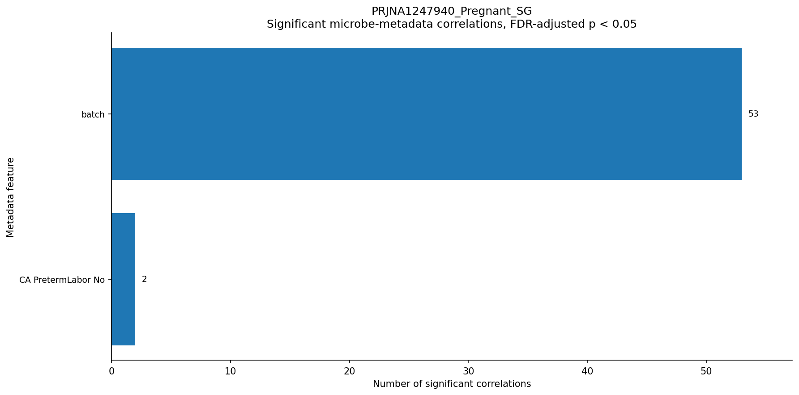
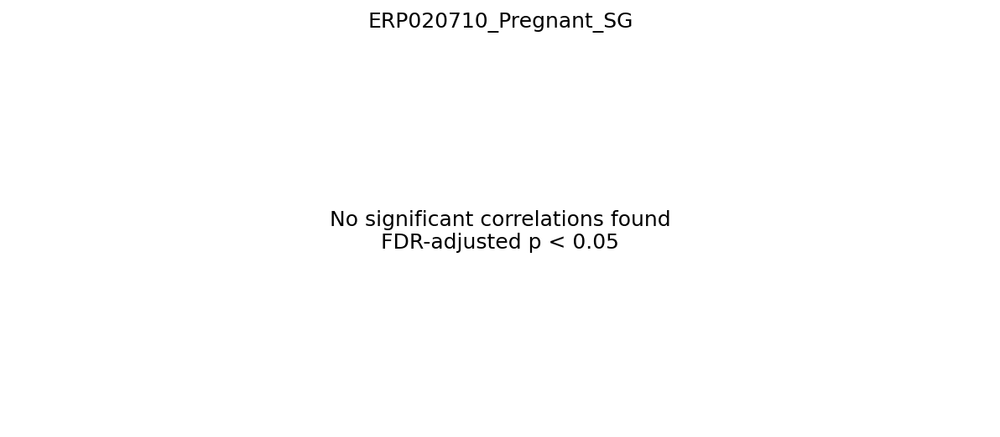
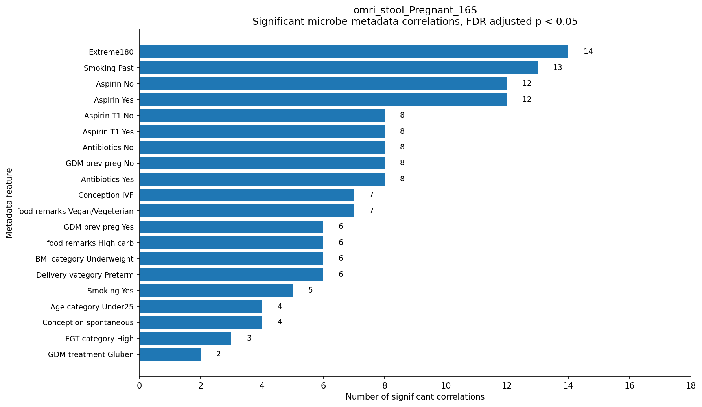
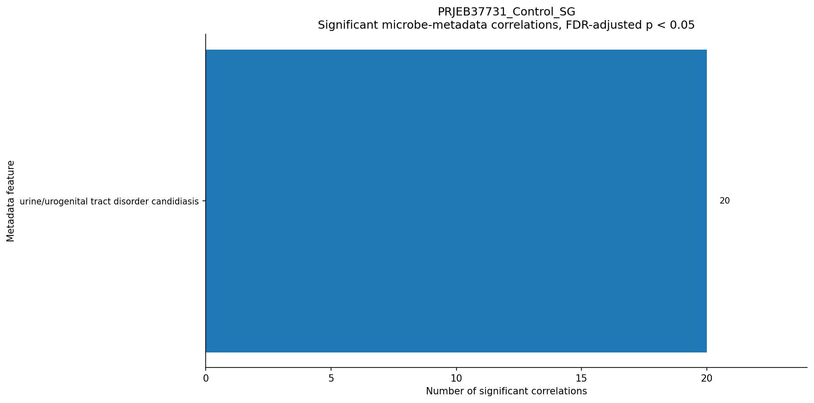

## Table of Contents

- [Projects Overview](#projects-overview)
- [Final figures presentation](#final-figures-presentation)
- [Taxa Changes](#taxa-changes)
- [Fig 2A - metadata comparison](#fig-2a---metadata-comparison)
- [Python Files Overview](#python-files-overview)

# Projects Overview

| Project Name | ID | Group    | Type | Country | # Samples | V   | metadata |
|--------------|-- | --------|------|---------|--------|------| -------- | 
| PRJNA1247940 | P_1_WGS | Pregnant | WGS  | USA   |  74    | V     | BMI, batch, Consent_Age, Delivery_EGA, country, Preeclampsia_During_Labor, PreTerm_Labor_EGA, tobacco_use, Birth Weight, delivery_type, sex_of_baby, PretermLabor, GDM, hypertension, Preeclampsia_At_PP, StillBirth |  
| ERP020710    | P_2_WGS | Pregnant | WGS  | China   |  55    | V     | Age, Body-mass index, Blood _glucose_t=0min, Blood_glucose_t=120mins, Blood_glucose_t=60mins, Disease status, Gestational weeks (fecal sample collection), Gestational weeks (OGTT testing) , Height, Total mass, (manually - https://gigadb.org/dataset/100326 )  | 
| PRJNA1254708 | P_1_16S | Pregnant | 16S  | China   |  63    | V     | none - need to contact authors |
| PRJEB58050   | P_2_16S | Pregnant | 16S  | Israel? |  382   | V     | BMI, Age, glucose, number of pregnancies, number of deliveries, way of conception, Antibiotics, Aspirin, Delivery_week, chronic medications, Smoking, Newborn_weight, stress test, education years, calories per day, carbs per day, food preferces |
|--------------|---| -------|------|---------|--------| ----  | ------- |
| PRJEB37731   | C_1_WGS | Control  | WGS  | Denmark |  160   | V     | host_body_mass_index, travel_outside_the_country_in_last_six_months, host_disease_status, presence_of_pets_or_farm_animals, drug_usage, urine/urogenital_tract_disorder |
| PRJNA48479   | C_2_WGS |Control  | WGS  | USA     |  100   | V     | nothing relevant
| PRJNA1067170 | - |Control  | WGS  | USA     |  124   | need permision to download  | 
| PRJNA669650  | C_1_16S  |Control  | 16S  | Finland |  208   | V      | Host_age, Host_disease (null/control)  |
| PRJNA388263  | C_2_16S  |Control  | 16S  | USA     |  400   | V  |  
| PRJNA545251  | C_3_16S  |Control  | 16S  | Barbados, Chile, South Africa, Thailand | 305 | V | https://www.nature.com/articles/s41598-022-21779-z |

---
# Final figures presentation

https://docs.google.com/presentation/d/1O0WzZP9HTSVLhiY_lHo22vqge5DtIZU-HPROSZ3wgoM/edit?usp=sharing

---

# Taxa Changes

**Higher in pregnancy:** Mann–Whitney q < 0.05, log2FC (pregnancy vs. control) ≥ 0.5, and the median abundance is higher in pregnancy in at least 80% of all pregnancy–control project comparisons.  
**Lower in pregnancy:** Mann–Whitney q < 0.05, log2FC (pregnancy vs. control) ≤ −0.5, and the median abundance is lower in pregnancy in at least 80% of all pregnancy–control project comparisons.  
**Appears in pregnancy:** Fisher q < 0.05, prevalence ≥ 20% in pregnancy, and prevalence ≤ 2% in controls.  
**Disappears in pregnancy:** Fisher q < 0.05, prevalence ≥ 20% in controls, and prevalence ≤ 2% in pregnancy.  
**Not candidate:** A tested taxon that does not meet any of the criteria above.  

## GENUS LEVEL

### Shotgun

Pregnancy projects: **ERP020710** and **PRJNA1247940**.
Control projects: **PRJEB37731** and **PRJNA48479**.

Results from the updated SG analysis: **358** tested genera, **127** pregnancy samples and **261** control samples. No samples were excluded for lacking informative genus abundance.

Source: [all_tested_taxa_results.csv](consistent_pregnancy_taxa_SG/all_tested_taxa_results.csv) and [candidate_taxa.csv](consistent_pregnancy_taxa_SG/candidate_taxa.csv).

| Category | Number of taxa |
|---|---:|
| Higher in pregnancy | 30 |
| Lower in pregnancy | 6 |
| Appears in pregnancy | 2 |
| Disappears in pregnancy | 0 |
| Not candidate | 320 |

Total candidate taxa: **38**

Additional reports: [genus matching](consistent_pregnancy_taxa_SG/genus_matching_summary.csv), [project summary](consistent_pregnancy_taxa_SG/project_summary.csv), [excluded samples](consistent_pregnancy_taxa_SG/excluded_samples.csv), and [analysis notes](consistent_pregnancy_taxa_SG/analysis_notes.txt).

#### Main taxa
**Shotgun — higher in pregnancy:**

- Adlercreutzia
- Anaerobutyricum
- Anaerostipes
- Anaerotignum
- Bilophila
- Blautia
- Clostridium
- Collinsella
- Dorea
- Eggerthella
- Enterocloster
- Eubacterium
- Evtepia
- Faecalibacillus
- Flavonifractor
- GGB9699
- Gemmiger
- Holdemania
- Hydrogenoanaerobacterium
- Intestinimonas
- Lachnoclostridium
- Lacrimispora
- Lentihominibacter
- Mediterraneibacter
- Oliverpabstia
- Phascolarctobacterium
- Pseudoflavonifractor
- Roseburia
- Streptococcus
- Vescimonas

**Shotgun — lower in pregnancy:**

- Akkermansia
- Alistipes
- Bacteroides
- Odoribacter
- Oscillibacter
- Parabacteroides

**Shotgun — appears in pregnancy:**

- Allisonella
- Megamonas

**Shotgun — disappears in pregnancy:**

None

### 16S

Pregnancy projects: **PRJEB58050** and **PRJNA1254708**.  
Control projects: **PRJNA669650**, **PRJNA388263**, and **PRJNA545251**.

Tested genera shared and observed in all five projects: **65**. Missing intermediate taxonomy ranks are allowed; genus names must be informative and match exactly, including suffixes.

Source: [candidate_taxa.csv](consistent_pregnancy_taxa_16S/candidate_taxa.csv).

| Category | Number of taxa |
|---|---:|
| Higher in pregnancy | 7 |
| Lower in pregnancy | 6 |
| Appears in pregnancy | 0 |
| Disappears in pregnancy | 0 |

Total candidate taxa: **13**

#### Main taxa

**16S — higher in pregnancy:**  

- Akkermansia
- Bifidobacterium_388775
- Collinsella
- Dialister_37762
- Escherichia
- Faecalibacterium
- Gemmiger_A_73129

**16S — lower in pregnancy:**  

- Alistipes_A_871400
- Anaerotignum_189125
- Bacteroides_H_857956
- Hominimerdicola
- Parabacteroides_B_862066
- Streptococcus

**16S — appears in pregnancy:**  
None

**16S — disappears in pregnancy:**  
None

---

## Species level

The species scripts use the same input projects, statistical tests, classification thresholds, and project consistency rules as the genus analyses above, with `TAXONOMY_LEVEL = 7`. Species labels must match exactly, including database suffixes; only species observed in every project of the respective analysis are tested. Samples without informative species abundance are excluded. Abundances are normalized over all informative species before matching.

| Category | Shotgun | 16S |
|---|---:|---:|
| Tested species | 552 | 48 |
| Higher in pregnancy | 40 | 5 |
| Lower in pregnancy | 8 | 2 |
| Appears in pregnancy | 5 | 0 |
| Disappears in pregnancy | 0 | 0 |
| Not candidate | 499 | 41 |
| Total candidate species | 53 | 7 |

### Shotgun 

Script: [taxa_changes_SG_species.py](taxa_changes_SG_species.py).

Retained samples: **127** pregnancy and **261** control. Excluded for lacking informative species abundance: **0**.

Sources: [all tested species](consistent_pregnancy_taxa_SG_species/all_tested_taxa_results.csv), [candidate species](consistent_pregnancy_taxa_SG_species/candidate_taxa.csv), [project summary](consistent_pregnancy_taxa_SG_species/project_summary.csv), [species matching](consistent_pregnancy_taxa_SG_species/species_matching_summary.csv), [excluded samples](consistent_pregnancy_taxa_SG_species/excluded_samples.csv), and [analysis notes](consistent_pregnancy_taxa_SG_species/analysis_notes.txt).

#### Main taxa

**Shotgun — higher in pregnancy:**

- Adlercreutzia_equolifaciens
- Anaerobutyricum_hallii
- Anaerobutyricum_soehngenii
- Anaerostipes_hadrus
- Bacteroides_stercoris
- Bilophila_wadsworthia
- Blautia_SGB4815
- Blautia_faecis
- Blautia_glucerasea
- Blautia_massiliensis
- Blautia_obeum
- Blautia_wexlerae
- Clostridia_bacterium_UC5_1_1D1
- Clostridiaceae_bacterium
- Clostridiaceae_bacterium_Marseille_Q4143
- Clostridiales_bacterium_KLE1615
- Clostridium_SGB4750
- Clostridium_leptum
- Clostridium_sp_AM22_11AC
- Collinsella_aerofaciens
- Coprococcus_catus
- Dorea_formicigenerans
- Dorea_longicatena
- Dorea_sp_AF36_15AT
- Eggerthella_lenta
- Evtepia_gabavorous
- Faecalibacillus_intestinalis
- Flavonifractor_plautii
- GGB9699_SGB15216
- Holdemania_filiformis
- Intestinimonas_butyriciproducens
- Lachnospira_pectinoschiza
- Lachnospiraceae_bacterium
- Lacrimispora_amygdalina
- Mediterraneibacter_faecis
- Oliverpabstia_intestinalis
- Roseburia_inulinivorans
- Ruminococcus_gnavus
- Streptococcus_salivarius
- bacterium_210917_DFI_7_65

**Shotgun — lower in pregnancy:**

- Alistipes_onderdonkii
- Alistipes_putredinis
- Bacteroides_ovatus
- Bacteroides_uniformis
- Faecalibacterium_sp_HTFF
- Lachnospiraceae_bacterium_CLA_AA_H244
- Odoribacter_splanchnicus
- Oscillibacter_valericigenes

**Shotgun — appears in pregnancy:**

- Allisonella_histaminiformans
- Clostridium_SGB4751
- Clostridium_sp_AF32_12BH
- Megamonas_funiformis
- Ruminococcus_sp_AF13_28

**Shotgun — disappears in pregnancy:**

None

### 16S 

Script: [taxa_changes_16S_species.py](taxa_changes_16S_species.py).

Retained samples: **893** pregnancy and **619** control. Excluded for lacking informative species abundance: **102**.

Sources: [all tested species](consistent_pregnancy_taxa_16S_species/all_tested_taxa_results.csv), [candidate species](consistent_pregnancy_taxa_16S_species/candidate_taxa.csv), [project summary](consistent_pregnancy_taxa_16S_species/project_summary.csv), [species matching](consistent_pregnancy_taxa_16S_species/species_matching_summary.csv), [excluded samples](consistent_pregnancy_taxa_16S_species/excluded_samples.csv), and [analysis notes](consistent_pregnancy_taxa_16S_species/analysis_notes.txt).

#### Main taxa

**16S — higher in pregnancy:**

- Akkermansia muciniphila_D_776786
- Blautia_A_141781 wexlerae
- Collinsella aerofaciens_F
- Faecalibacterium prausnitzii
- Gemmiger_A_73129 qucibialis

**16S — lower in pregnancy:**

- Anaerotignum faecicola
- Hominimerdicola aceti

**16S — appears in pregnancy:**

None

**16S — disappears in pregnancy:**

None

Species labels are shown exactly as saved in the results. “Appears” and “disappears” refer to prevalence thresholds among matched species, not absolute presence/absence or a causal pregnancy effect.

---
# Fig 2A - metadata comparison 

This figure shows the number of significant correlations  
(adjusted p-value < 0.05) between metadata features and microbial taxa,  
for each dataset separately.

## Status    
| Project Name | Group    | Type | Status |
|--------------|----------|------|--------|
| PRJNA1247940 | Pregnant | WGS  | 55 significant correlations (to batch) |
| ERP020710    | Pregnant | WGS  | 0 significant correlations | 
| PRJNA1254708 | Pregnant | 16S  | skip - no metadata | 
| omri_stool   | Pregnant | 16S  | 165 significant correlations  |
|--------------|----------|------|--------|
| PRJEB37731   | Control  | WGS  | 20 significant correlations       | 
| PRJNA48479   | Control  | WGS  | skip - no metadata | 
| PRJNA669650  | Control  | 16S  | no usable metadata  | 

## Figures  

| Project Name | Group    | Type | Figure |  
|--------------|----------|------|--------|
| PRJNA1247940 | Pregnant | WGS  |  |
| ERP020710    | Pregnant | WGS  |  | 
| PRJNA1254708 | Pregnant | 16S  | skip - no metadata | 
| omri_stool   | Pregnant | 16S  |   |
|--------------|----------|------|--------|
| PRJEB37731   | Control  | WGS  |        | 
| PRJNA48479   | Control  | WGS  | skip - no metadata | 
| PRJNA669650  | Control  | 16S  | no usable metadata  | 

---

# Python Files Overview

- `1_set_cols_per_ds.py`  
  Input: A raw YaMAS shotgun CSV selected in the script.  
  Output: A CSV with the first column renamed to SampleID, saved beside the input as *_formatted.csv.

- `preprocess_16S.py`  
  Input: YaMAS OTU and taxonomy CSV pairs in datasets_after_yamas/16S/.  
  Output: Raw and relative-abundance taxonomy tables in datasets_after_MIPMLP/ (*_GROUP_16S.csv and *_GROUP_16S_formatted.csv).

- `fig_1B_full_SG.py`  
  Input: Formatted shotgun abundance CSVs in datasets_after_yamas/SG/.  
  Output: Phylum composition stacked bars, a combined violin plot, and violin observations CSV in 1B_plots/SG/.

- `fig_1B_SG_family.py`  
  Input: Formatted shotgun abundance CSVs in datasets_after_yamas/SG/.  
  Output: Family composition stacked bars, a combined violin plot, and violin observations CSV in 1B_plots/SG_family/.

- `fig_1B_16S.py`  
  Input: Relative-abundance *_16S_formatted.csv tables in datasets_after_MIPMLP/.  
  Output: Phylum composition stacked bars and a combined violin plot in 1B_plots/16S/.

- `fig_1C_SG.py`  
  Input: Four formatted shotgun abundance tables from datasets_after_yamas/SG/.  
  Output: A Shannon diversity comparison plot in 1C_plots/1C_SG.png.

- `fig_1C_16S.py`  
  Input: YaMAS OTU tables for PRJNA669650 and PRJNA1254708, plus the prepared Omri stool table.  
  Output: A Shannon diversity comparison plot in 1C_plots/1C_16S.png.

- `fig_1D_SG.py`  
  Input: Formatted shotgun abundance CSVs in datasets_after_yamas/SG/.  
  Output: GIMIC input and group CSVs in 1D_SG/Control_VS_Pregnant/ and a comparison plot in 1D_SG/figure_plots/.

- `fig_1D_16S.py`  
  Input: YaMAS OTU/taxonomy pairs for PRJNA669650 and PRJNA1254708, plus the prepared Omri stool table.  
  Output: GIMIC input and group CSVs in 1D_16S/Control_VS_Pregnant/ and a comparison plot in 1D_16S/figure_plots/.

- `fig_1E_SG.py`  
  Input: Four formatted shotgun abundance tables from datasets_after_yamas/SG/.  
  Output: miMic results, tree plots, logs, and a summary for four pairs in 1E_SG/pairs_p0.01/; --pooled saves the combined comparison.

- `fig_1E_16S.py`  
  Input: Five prepared 16S abundance tables from datasets_after_MIPMLP/.  
  Output: miMic results, tree plots, logs, and a summary for six pairs in 1E_16S/pairs_p0.05/; --pooled saves the combined comparison.

- `mimic_pairwise.py`  
  Input: A comparison function, control/pregnancy project lists, output folder, and significance threshold.  
  Output: Separate comparison folders with run.log files and comparison_summary.csv in the supplied output folder.

- `compare_1E_taxa.py`  
  Input: Existing pooled and pairwise 1E inputs, miMic results, and comparison summaries for shotgun and 16S.  
  Output: Taxon comparison CSVs and searchable HTML in 1E_SG/comparison_tables_p0.01/ and 1E_16S/comparison_tables_p0.05/.

- `taxa_changes_SG.py`  
  Input: Four formatted shotgun abundance tables from datasets_after_yamas/SG/.  
  Output: Genus-level statistics, pregnancy candidate taxa, and matching/sample reports in consistent_pregnancy_taxa_SG/.

- `taxa_changes_16S.py`  
  Input: Five prepared 16S abundance tables from datasets_after_MIPMLP/.  
  Output: Genus-level statistics, pregnancy candidate taxa, and matching/sample reports in consistent_pregnancy_taxa_16S/.

- `taxa_changes_SG_species.py`  
  Input: Four formatted shotgun abundance tables from datasets_after_yamas/SG/.  
  Output: Species-level statistics, pregnancy candidate taxa, and matching/sample reports in consistent_pregnancy_taxa_SG_species/.

- `taxa_changes_16S_species.py`  
  Input: Five prepared 16S abundance tables from datasets_after_MIPMLP/.  
  Output: Species-level statistics, pregnancy candidate taxa, and matching/sample reports in consistent_pregnancy_taxa_16S_species/.

- `fig_2A.py`  
  Input: Per-project microbiome abundance CSVs and matching sample metadata CSVs.  
  Output: Correlation tables, significant-correlation counts, and PNG/PDF plots per project, plus combined CSVs, in fig_2A/.

- `updated_miMic_test/miMic_test.py`  
  Input: SAMBA outputs, sample group labels, and miMic analysis/plot settings supplied by the 1E scripts.  
  Output: miMic statistical result CSVs and taxonomic tree/interaction plots in the supplied comparison folder.

- `updated_miMic_test/tax_tree_create.py`  
  Input: A pandas Series of taxonomy paths and abundance values.  
  Output: An in-memory NetworkX directed taxonomy graph with abundance values; no files are written.
